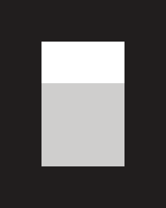

# Hi there 👋 I'm fjotas

**Developer · Designer · Tech Enthusiast**

Always experimenting, building projects and exploring new technologies.

Currently exploring **Vibe Coding, Cybersecurity, UI/UX Design and Software Development.**

---

## 💻 Programming & Development

  

## 🌐 Web Development

  

## 🎨 Design & Creative Tools

  

## 🛠️ Tools & Environment

  

## 🤖 AI-Assisted Development

  

---

